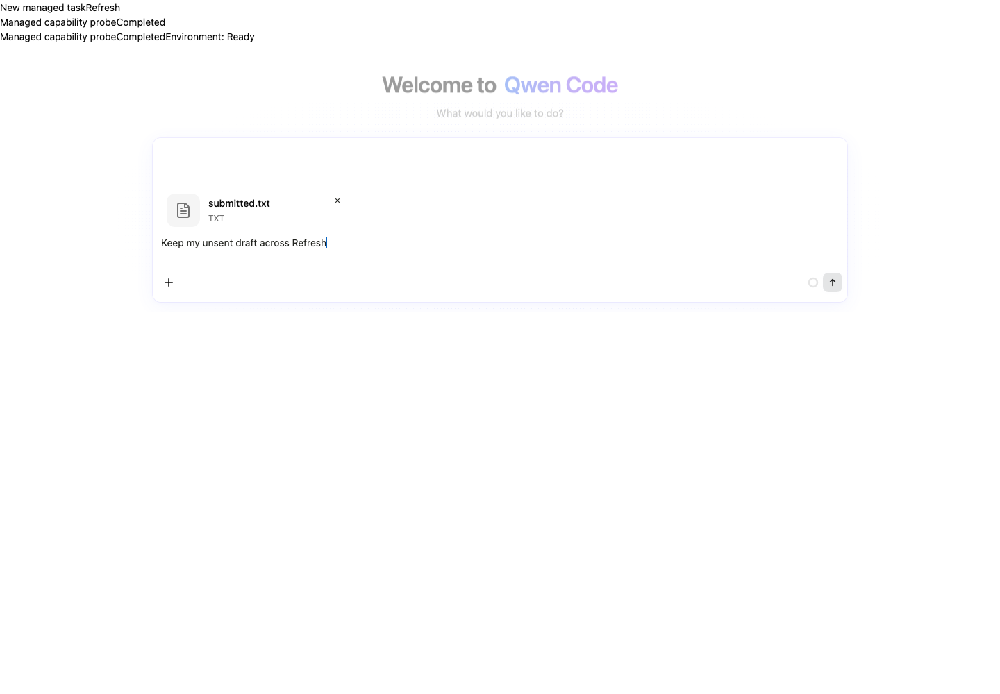
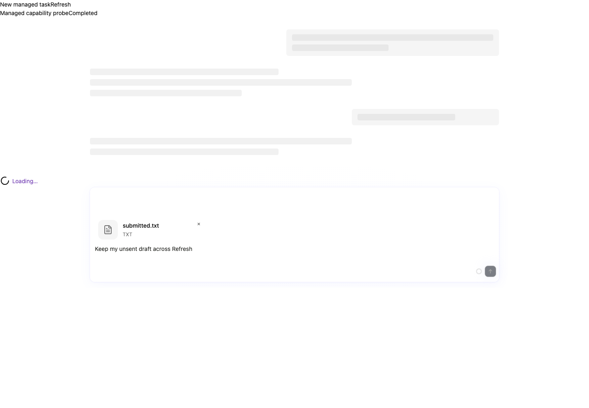
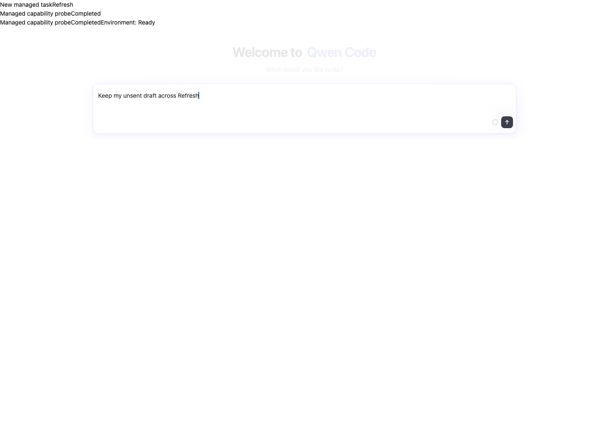

# Composer draft follow-up verification / 输入框草稿后续修复验证

Implementation: `c1c50c3177e79a809fc884a07eba53e9e0d70c56`, based on main `32b4234b849c229b0e5ed9ec6ddf987f3318c67e`. This fixes two defects left by merged [PR #15025](https://github.com/QwenLM/qwen-code/pull/15025): attachment loss during Managed summary refresh and accepted draft retention after allocation.

实现提交为 `c1c50c3177e79a809fc884a07eba53e9e0d70c56`，基于 main `32b4234b849c229b0e5ed9ec6ddf987f3318c67e`，修复已合入 [PR #15025](https://github.com/QwenLM/qwen-code/pull/15025) 遗留的两个问题：托管摘要刷新期间附件丢失，以及分配会话后已接受草稿残留。

## Reproduction and regression evidence / 复现与回归证据

The exact merged baseline `f18decc7cc240809fd421f2e0e8285b49b536177` reproduced both defects in production-hook browser tests. Before the production fix, the focused permanent regression selection had 8 failing cases and 6 passing controls; after the fix all 14 passed. The initial unbuilt workspace SDK collection failure was setup failure, not bug reproduction.

已合入基线 `f18decc7cc240809fd421f2e0e8285b49b536177` 的生产 hook 浏览器测试复现了两个问题。生产修复前，聚焦永久回归有 8 项失败、6 项对照通过，修复后 14 项全部通过。最初工作区 SDK 尚未构建造成的收集失败属于环境准备失败，不计为缺陷复现。

On the current rebased implementation: 527 cases across seven related regression files plus 32 existing attachment-deletion cases passed (559 total). The full repository build, typecheck and bundle passed, as did changed-file ESLint, Prettier and diff whitespace checks. Two clean self-review passes and a separate independent source review found no actionable issue.

当前 rebase 后提交：7 个相关回归文件的 527 项，以及现有附件删除测试的 32 项均通过，共 559 项。完整仓库 build、typecheck、bundle 及改动文件 ESLint、Prettier、diff 空白检查均通过。两轮干净自审和独立源码复核未发现需要处理的问题。

## Browser verification / 浏览器验证

macOS, Chromium `149.0.7827.55`. All 9 actual production-hook cases and all 3 actual ManagedSessionsPage/ChatEditor cases passed with zero page errors. All seven candidate source hashes were checked before and after; no source changes occurred during verification.

macOS、Chromium `149.0.7827.55`。9 项实际生产 hook 案例与 3 项实际托管页面/输入框案例全部通过，无页面错误。运行前后核对全部 7 个候选文件哈希，验证期间源码未变化。

- Managed Refresh: hold the actual summary response after clicking Refresh. Text, native image bytes and native File contents/size remain during Loading and after a supported response. An actual capability=false response removes attachments/archive and retains text.
- Owner changes: switching session or provider while loading starts the new composer without inherited attachment permission and preserves the old owner's archive.
- Allocation: after removing a submitted image, desktop allocation with and without a sibling file clears accepted text/archive and stays clear on React remount. No-edit touch allocation with persisted references also clears. The strict continuation guard remains false after removal and true for no-edit normalization.
- Controls: desktop/mobile ordinary allocation, active/departed acceptance with a sibling's held native FileReader, and explicit-clear cancellation pass. Permanent DOM regressions additionally cover newer text, edit-undo, new file, navigation and unmount outcomes.

- 托管刷新：点击实际 Refresh 按钮后延迟摘要响应。Loading 期间及支持附件响应返回后，文字、图片原始字节、原生 File 内容与大小均保留。实际 capability=false 响应会移除附件/归档并保留文字。
- 归属切换：加载期间切换会话或 provider，新输入框不继承旧附件权限，旧归属归档保留。
- 会话分配：桌面端删除已提交图片后，无论是否有剩余文件，分配后接受确认均清理文字与归档，React 重挂载后不恢复。触屏持久化引用未编辑草稿也能清理。严格继续提交守卫在删除后仍为 false，未编辑归一化场景为 true。
- 对照：桌面/移动普通分配、同会话其他视图原生 FileReader 尚未完成时当前/已离开视图的接受保护、显式清空取消均通过。永久 DOM 回归还覆盖新文字、编辑后撤销、新文件、切走及卸载。

## Screenshots / 截图

All three screenshots were individually inspected. The actual composer shows the file chip and text before Refresh and during Loading; after explicit revocation the chip is removed while text remains. Actual application root/theme/CSS scoping are reused; the surrounding header has standalone harness presentation. The image fixture is a 1px PNG: image count/bytes are verified through DOM/native archive assertions, not a visually distinct thumbnail.

三张截图均已逐张检查：实际输入框在刷新前及 Loading 期间显示文件卡片与文字，明确撤销能力后卡片消失、文字保留。复用实际应用根节点/主题/CSS 作用域，周围标题区域采用独立 harness 展示。图片夹具为 1px PNG，其数量/字节通过 DOM 和原生归档断言验证，不宣称存在可辨认缩略图。

## Boundaries / 验证边界

These are source-dev Vite imports of actual production components/hooks with native IndexedDB, localStorage, File and FileReader. Provider responses, allocation, acceptance and reader timing are controlled. No real daemon/model/Git backend, compiled-bundle browser execution, native mobile Safari, Windows or Linux execution is claimed. The root bundle is validated separately. The previous workspace-resolution issue remains deferred.

测试通过 Vite 开发模式引入实际生产组件/hook，使用原生 IndexedDB、localStorage、File、FileReader。provider 响应、分配、接受及读取时序受控。未验证真实 daemon/模型/Git 后端、编译后 bundle 的浏览器执行、原生移动 Safari、Windows 或 Linux。根 bundle 单独检查。此前工作区解析问题仍延期处理。

An additional standalone full-editor migration harness could not render because its voice button requires workspace provider context; it is excluded from passing E2E counts. Allocation is verified through the actual production hook and permanent DOM regressions. Initial screenshots missing the real root/theme were rejected; only the corrected three screenshots above are published. Test servers were stopped and the implementation working tree remained clean.

额外独立完整输入框迁移 harness 因语音按钮依赖工作区 provider 上下文而未能渲染，不计入通过的 E2E 数量。分配行为由实际生产 hook 和永久 DOM 回归验证。最初缺少实际根节点/主题的截图被弃用，只发布上方三张修正截图。测试服务器已关闭，实现工作区保持干净。
